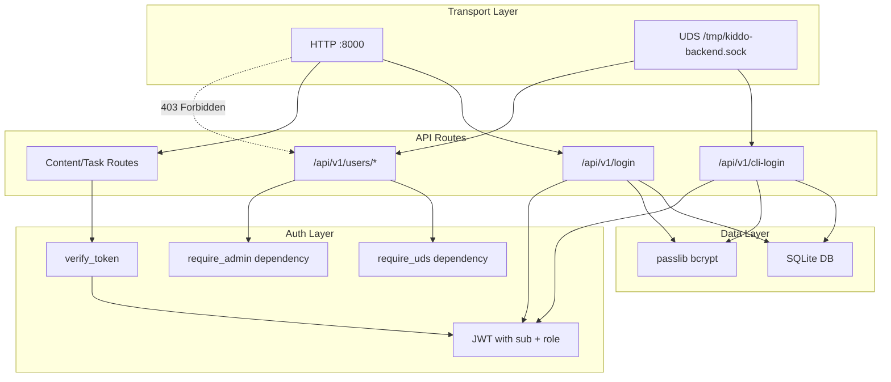

# Backend Authorization Overhaul with SQLite User Store

## Current State

- JWT tokens contain only `sub` (username) and `exp` -- no role information
- Credentials are hardcoded as `admin`/`admin` in [routes_auth.py](backend/src/api/v1/routes_auth.py)
- `passlib[bcrypt]` is already a dependency but unused
- No database exists -- all storage is filesystem-based
- UDS-only gating exists via `_is_unix_socket_request()` in `routes_auth.py`
- `verify_token` returns a plain username string; `get_current_user` forwards it

## Architecture

## Changes

### 1. SQLite Database Layer (new files)

**New file: [backend/src/db/database.py](backend/src/db/database.py)**

- Use Python's built-in `sqlite3` module (no extra dependencies needed)
- `init_db()`: create `users` table if not exists with columns: `id INTEGER PRIMARY KEY`, `username TEXT UNIQUE NOT NULL`, `role TEXT NOT NULL DEFAULT 'viewer'`, `hashed_password TEXT NOT NULL`
- `get_db()`: return a connection (used as a dependency or called directly)
- DB file path from new config setting `DB_PATH` (default: `data/users.db`)
- On first init, seed a default `admin` user with bcrypt-hashed password `MarXman2025`and role `admin`

**New file: [backend/src/db/init.py](backend/src/db/__init__.py)** -- empty

### 2. Extend JWT with Role (modify existing files)

**[backend/src/security/tokens.py](backend/src/security/tokens.py)**

- No changes needed -- `create_access_token(data=...)` already accepts arbitrary `data` dict; callers will pass `role`

**[backend/src/api/v1/routes_auth.py](backend/src/api/v1/routes_auth.py)**

- Replace hardcoded credential checks with DB lookup + bcrypt verify
- Include `role` in the JWT payload: `data={"sub": user.username, "role": user.role}`
- Extract `_is_unix_socket_request` into a shared dependency (see below)

### 3. Update Auth Dependencies (modify existing files)

**[backend/src/security/auth.py](backend/src/security/auth.py)**

- `verify_token` returns a dict `{"username": ..., "role": ...}` instead of a plain string
- Extract `role` from JWT payload alongside `sub`
- In `AUTH_DISABLED` mode, return `{"username": "dev-user", "role": "admin"}`

**[backend/src/api/dependencies.py](backend/src/api/dependencies.py)**

- `get_current_user` returns the dict from `verify_token`
- Add `require_uds` dependency (moved from `routes_auth.py`) that raises 403 if not UDS
- Add `require_admin` dependency that checks `current_user["role"] == "admin"`

### 4. User Management Endpoints (new file)

**New file: [backend/src/api/v1/routes_users.py](backend/src/api/v1/routes_users.py)**

All endpoints guarded by both `require_uds` and `require_admin` dependencies.

| Method | Path | Description |
| ------ | ---- | ----------- |

- `POST /api/v1/users` -- Create user (username, password, role)
- `GET /api/v1/users` -- List all users (returns id, username, role -- no passwords)
- `DELETE /api/v1/users/{username}` -- Delete user (prevent deleting last admin)
- `PATCH /api/v1/users/{username}/password` -- Change password
- `PATCH /api/v1/users/{username}/role` -- Change role

Pydantic request/response schemas defined in the same file or a separate schemas file.

### 5. Config Update

**[backend/src/core/config.py](backend/src/core/config.py)**

- Add `DB_PATH: str = "data/users.db"` setting
- Add `DEFAULT_ADMIN_PASSWORD: str = "admin"` for initial seed (overridable via env)

### 6. App Startup

**[backend/src/main.py](backend/src/main.py)**

- Import and call `init_db()` on startup (using `@app.on_event("startup")` or lifespan)
- Register `routes_users.router` with prefix `settings.API_V1_STR` and tag `"users"`

### 7. Cascade Updates

**[backend/src/api/v1/routes_tasks.py](backend/src/api/v1/routes_tasks.py)** and **[backend/src/api/v1/routes_content.py](backend/src/api/v1/routes_content.py)**

- Update any usage of `current_user` that assumes it is a string -- it will now be a dict with `username` and `role` keys

### 8. Dependencies (no new packages needed)

- `sqlite3` is in Python's standard library
- `passlib[bcrypt]` is already in [requirements.txt](backend/requirements.txt)
- No new pip dependencies required

### 9. Docker Considerations

**[docker/backend.Dockerfile](docker/backend.Dockerfile)**

- Ensure `data/` directory exists or is created at runtime for the SQLite file
- Consider adding a volume mount for `data/` in [docker-compose.yml](docker/docker-compose.yml) to persist the DB

## Roles

Two built-in roles: `admin` and `viewer`. Only `admin` can manage users. Both roles can access content/task endpoints. This can be extended later.