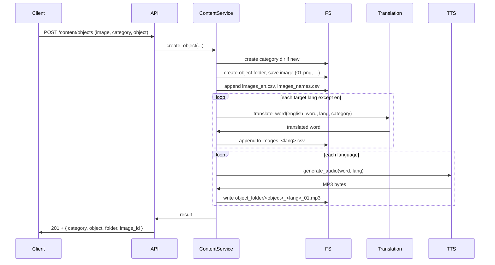

# Backend content management and CLI plan

## Current state

- **Backend**: FastAPI in [backend/src](ContentManagement/backend/src) with auth, tasks router, and `DATA_DIRECTORY` in [backend/src/core/config.py](ContentManagement/backend/src/core/config.py) (default `./content`). Services in [backend/src/core/services.py](ContentManagement/backend/src/core/services.py) already list files under that directory.
- **Docker**: [docker/docker-compose.yml](ContentManagement/docker/docker-compose.yml) mounts `./content:/app/content` for the backend; compose is intended to be run from repo root so the content path should be `../content:/app/content` when run from the `docker/` directory, or use a single compose from repo root with `content:/app/content` and `./content` as host path.
- **Frontend**: Vue 3, proxy to backend, auth and dashboard; can later add UI for categories and create-object.
- **Content layout** (from [content/foods](ContentManagement/content/foods) and [content/drinks](ContentManagement/content/drinks)):
  - One folder per **category** (e.g. `foods`, `drinks`).
  - Per category: `images_en.csv`, `images_fr.csv`, `images_es.csv`, `images_bg.csv` (one word per line), and `images_names.csv` (one `I_<PascalCase>` id per line); object folders as immediate children (e.g. `oatmeal`, `apple_pie`).
  - Per **object folder**: voice files (e.g. `*_en_01.mp3`) and images (e.g. `01.png`).

## In-backend core: ported logic (no existing_scripts)

Do **not** use or depend on the `existing_scripts` folder. Duplicate and integrate the following into the backend core so the CMS is self-contained; you can remove `existing_scripts` once the CMS is ready.

| Original script  | Port into backend                                                                | Purpose                                                                                                                                                                                                                                                                                                                                                                                                     |
| ---------------- | -------------------------------------------------------------------------------- | ----------------------------------------------------------------------------------------------------------------------------------------------------------------------------------------------------------------------------------------------------------------------------------------------------------------------------------------------------------------------------------------------------------- |
| translate_csv.py | **Translation service** (e.g. `src/core/translation.py`)                         | Translate English word(s) to target language(s) via OpenAI chat (same prompt: noun, singular, no articles; optional category context). Expose `translate_word(text, target_lang_code, category=None) -> str` and optionally `translate_words(words: list, target_lang_code, category=None) -> list` for batch. Use the same `LANG_MAP` (en, de, fr, it, es, pl, uk, ro, nl, bg) and model `gpt-4o`.         |
| generate.py      | **TTS service** (e.g. `src/core/tts.py`)                                         | Generate speech for one word in a given language via OpenAI Audio API. Expose `generate_audio(word: str, lang: str) -> bytes` (or write to path). Use same voice (`alloy`) and model (`tts-1-hd`); no need for CSV input—content service passes a single word per language.                                                                                                                                 |
| names_export.py  | **Naming helpers** (e.g. `src/core/content_naming.py` or inside content_service) | Pure helpers: `english_word_to_folder_name(word: str) -> str` (e.g. `"apple pie"` → `apple_pie`), `english_word_to_image_id(word: str) -> str` (e.g. `"apple pie"` → `I_ApplePie` using same PascalCase logic as names_export). Optionally: `scan_category_folders(category_path) -> (list of display names, list of I_ ids)` to regenerate `images_en.csv` / `images_names.csv` from disk if needed later. |

- **Dependencies**: Add `openai` to [backend/requirements.txt](ContentManagement/backend/requirements.txt) and [backend/pyproject.toml](ContentManagement/backend/pyproject.toml). No pandas/openpyxl unless you later port csv_export for Unity.
- **Configuration**: Backend needs `OPENAI_API_KEY` (env) when using translation or TTS. No `SCRIPTS_DIR`; no copy or mount of `existing_scripts` in Docker.

---

## 1. Configuration

- **Backend** ([backend/src/core/config.py](ContentManagement/backend/src/core/config.py)):
  - Keep `DATA_DIRECTORY` (default `./content`); in Docker set env `DATA_DIRECTORY=/app/content` so the mounted volume is used.
  - Add: `SUPPORTED_LANGUAGES` (e.g. `["en", "fr", "es", "bg"]`), and `OPENAI_API_KEY: str | None` (optional; if missing, create-object can fail when calling translate/TTS or you can make those calls conditional).
- **Docker**: In [docker/docker-compose.yml](ContentManagement/docker/docker-compose.yml), set backend env: `DATA_DIRECTORY=/app/content`, and pass `OPENAI_API_KEY` from host env (no default in file). Do **not** copy or mount `existing_scripts`.

---

## 2. Content service layer

Introduce a **content service** (e.g. in `backend/src/core/content_service.py`) that:

- Uses `settings.DATA_DIRECTORY` as the content root and the **naming helpers** (folder name, image id from English word).
- **List categories**: list immediate subdirs of content root (exclude hidden and non-directories); return names.
- **Category details**: for a given category name, return: list of object folders (names), and optionally contents of `images_*.csv` / `images_names.csv` for that category.
- **Create object** (orchestration, using **in-process** translation and TTS):
  1. **Validate**: category name (allowed chars), English object name (non-empty), image file (e.g. PNG/JPEG).
  2. **Normalize names**: use naming helpers—object folder = `english_word_to_folder_name(object)` (e.g. `apple_pie`); image id = `english_word_to_image_id(object)` (e.g. `I_ApplePie`).
  3. **Create category dir** if it does not exist.
  4. **Create object folder** under category.
  5. **Save image**: in object folder, first free index (e.g. `01.png`, `02.png`); save uploaded file with that name (and optionally normalize to PNG / 1k size later).
  6. **Update CSVs** (category folder): Append one line to `images_en.csv` (English word) and one line to `images_names.csv` (I_PascalCase). For each target language in `SUPPORTED_LANGUAGES` excluding `en`, call **translation service** `translate_word(english_word, lang, category)` and append the result to `images_<lang>.csv` (create file if new category).
  7. **Generate voices**: for each language in `SUPPORTED_LANGUAGES`, get the word (English for `en`, else the translated word from the new line). Call **TTS service** `generate_audio(word, lang)` to get MP3 bytes, then write to object folder as `<object_folder>_<lang>_01.mp3`.
  8. **New category**: no extra step; first object creates the CSVs and voices as above.

All translation and TTS are **in-process** calls to `src.core.translation` and `src.core.tts`; no subprocesses or `existing_scripts`.

---

## 3. API endpoints

New router under `backend/src/api/v1/` (e.g. `routes_content.py`), prefix `/api/v1`, protected by existing `get_current_user` where applicable:

| Method | Path                                  | Purpose                                                                                                                                                           |
| ------ | ------------------------------------- | ----------------------------------------------------------------------------------------------------------------------------------------------------------------- |
| GET    | `/content/categories`                 | **list_categories** – return list of category names.                                                                                                              |
| GET    | `/content/categories/{category_name}` | **category_details** – return object list and optionally CSV-derived data (words per language, image ids).                                                        |
| POST   | `/content/objects`                    | **create object** – body: multipart/form-data with `image` (file), `category` (string), `object` (string, English word). Calls content service create flow above. |

Response shapes: e.g. `list_categories` → `{"categories": ["foods", "drinks"]}`; `category_details` → `{"name": "foods", "objects": ["oatmeal", ...], "images_en": [...], ...}` (or minimal object list only); create → `{"category": "...", "object": "...", "folder": "...", "image_id": "I_..."}`.

Include the new router in [backend/src/main.py](ContentManagement/backend/src/main.py).

---

## 4. CLI: mirror FastAPI endpoints

Goal: **use all FastAPI endpoints from the host** via CLI. Implement the CLI as an **HTTP client** to the running backend (no duplicate business logic).

- **Config**: backend base URL (e.g. `BACKEND_URL` env or `--url`, default `http://localhost:8000`). Optional: token for auth (e.g. `--token` or env `KIDDO_TOKEN`); if you add token-based auth for CLI, use the same login endpoint to obtain it.
- **Typer commands** in [backend/src/cli/main.py](ContentManagement/backend/src/cli/main.py) (or a dedicated `cli/commands/content.py`):
  - `list-categories` → GET `/api/v1/content/categories`.
  - `category-details <name>` → GET `/api/v1/content/categories/{name}`.
  - `create-object --image <path> --category <name> --object <english_word>` → POST `/api/v1/content/objects` with multipart form (file + fields).
  - Keep or extend existing commands (e.g. `list` → existing list endpoint) so that every content-related FastAPI endpoint has a corresponding CLI command.

Implementation: use `requests` (already in [backend/pyproject.toml](ContentManagement/backend/pyproject.toml)) for GET/POST; for create-object, send `requests.post(..., files={"image": open(...)}, data={"category": ..., "object": ...})`. Print JSON or a short success message. If backend is unreachable, exit with a clear error (e.g. “Backend not available at …”).

---

## 5. Docker and content volume

- Ensure the content directory on the host is the one that contains `foods/`, `drinks/`, etc. In [docker/docker-compose.yml](ContentManagement/docker/docker-compose.yml), use a host path that resolves to that directory (e.g. from repo root: `./content:/app/content` when compose is run from repo root; or from `docker/`: `../content:/app/content`).
- Backend container: set env `DATA_DIRECTORY=/app/content` and `OPENAI_API_KEY` (from host env). Do **not** copy or mount `existing_scripts`; all logic lives in the backend image.

---

## 6. Flow summary (create object)

---

## 7. Optional / later

- **Auth for CLI**: use existing login endpoint, store token, send `Authorization: Bearer <token>` from CLI.
- **Frontend**: add views that call `GET /content/categories`, `GET /content/categories/:name`, and a form that uploads image + category + object and calls `POST /content/objects`.
- **Image resize**: optional step in content service to convert/resize to 1k PNG if required.
- **csv_export.py**: if you need a full asset manifest (e.g. for Unity), port that logic into the backend later or add a separate export endpoint; not required for the create-object flow.

---

## File changes (summary)

| Area              | Action                                                                                                                                                 |
| ----------------- | ------------------------------------------------------------------------------------------------------------------------------------------------------ |
| Config            | Add `SUPPORTED_LANGUAGES`, `OPENAI_API_KEY`; ensure `DATA_DIRECTORY` used in Docker. No `SCRIPTS_DIR`.                                                 |
| Core: naming      | New module (e.g. `content_naming.py`): `english_word_to_folder_name`, `english_word_to_image_id` (PascalCase + `I`_).                                  |
| Core: translation | New module (e.g. `translation.py`): `translate_word(text, target_lang, category=None)` using OpenAI chat, same prompt and LANG_MAP as existing script. |
| Core: TTS         | New module (e.g. `tts.py`): `generate_audio(word, lang) -> bytes` using OpenAI Audio API (voice alloy, model tts-1-hd).                                |
| Content service   | New module: list categories, category details, create object (folder + CSVs + in-process translation + in-process TTS).                                |
| API               | New router: `GET /content/categories`, `GET /content/categories/{name}`, `POST /content/objects`.                                                      |
| CLI               | New commands: `list-categories`, `category-details`, `create-object`; HTTP client to backend.                                                          |
| Dependencies      | Add `openai` to requirements.txt and pyproject.toml.                                                                                                   |
| Docker            | Env for backend (`DATA_DIRECTORY`, `OPENAI_API_KEY`), mount content only; no `existing_scripts`.                                                       |

This keeps a single source of truth in the backend: all translation and TTS logic lives in core modules, so you can remove the `existing_scripts` folder once the CMS is ready. Every endpoint remains usable from both the Vue frontend and the host CLI.