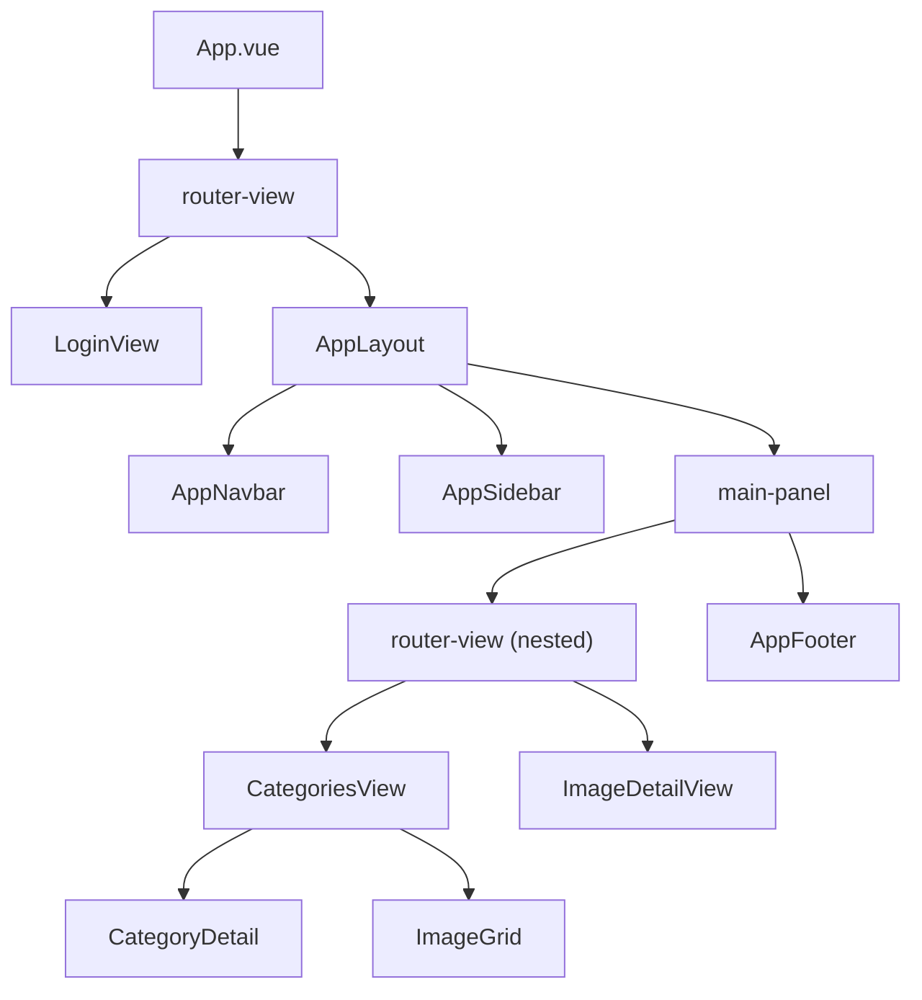

# Categories Management UI

## 1. Copy vue3-demo Styles and Assets

Copy the entire `src/assets/` tree from `D:\MarXman\vue3-demo` to the frontend project, merging with existing assets (keeping `auth.css`, `login_1.jpg`, `icon-google.svg`).

Directories to copy:

- `vendors/` -- Bootstrap base, vendor addons, MDI icons, Font Awesome, Ionicons, flag-icons, Feather icons, Chart.js
- `css/shared/style.css` (+map) -- core Star Admin styles (~10K lines: grid, cards, forms, buttons, tables, sidebar, navbar, footer, auth, etc.)
- `css/demo_1/style.css` (+map) -- demo skin (navbar, sidebar theme, cards, layout overrides)
- `images/` -- faces, logos, sprites, file-icons, etc. (merge with existing `auth/` and `file-icons/`)

Update [main.ts](src/main.ts) to import the same CSS chain as vue3-demo:

```typescript
import './assets/vendors/iconfonts/mdi/css/materialdesignicons.min.css'
import './assets/vendors/iconfonts/flag-icon-css/css/flag-icon.min.css'
import './assets/vendors/font-awesome/css/font-awesome.min.css'
import './assets/vendors/css/vendor.bundle.base.css'
import './assets/vendors/css/vendor.bundle.addons.css'
import './assets/css/shared/style.css'
import './assets/css/demo_1/style.css'
import './assets/css/auth.css'
```

## 2. TypeScript Interfaces

Create `src/types/index.ts` with domain types:

```typescript
interface Voice {
  id: string
  name: string
  language: 'en' | 'es' | 'fr' | 'bg'
  type: string  // e.g. "male", "female", "ambient"
  iconUrl: string
}

interface Image {
  id: string
  name: string
  files: string[]        // image file URLs, at least 1
  voices: Voice[]        // exactly 1 per language (4 total)
  thumbnailUrl: string   // first file, for grid display
}

interface Category {
  id: string
  name: string
  description: string
  iconUrl: string
  voices: Voice[]        // category-level voices per language
  images: Image[]
}
```

## 3. Mock Data

Create `src/data/mockData.ts` with 4 mock categories, each containing 4-8 images with placeholder image files (reusing vue3-demo sample images from `assets/images/samples/`). Voices use flag icons for language identification.

## 4. Route Structure

Update [router/index.ts](src/router/index.ts):

- `/login` -- LoginView (existing, no layout)
- `/` -- redirect to `/categories`
- `/categories` -- CategoriesView (selects first category by default)
- `/categories/:categoryId` -- CategoriesView (specific category selected)
- `/categories/:categoryId/images/:imageId` -- ImageDetailView

All `/categories` routes use the new `AppLayout` with sidebar+navbar. Auth guard remains.

## 5. Application Layout

Restructure [App.vue](src/App.vue) to use `<router-view>` only. The layout wrapping moves into route-level components.

Create `src/layouts/AppLayout.vue` -- the main authenticated layout:

```
div.container-scroller
  ├── AppNavbar (top bar: search, language, user avatar)
  └── div.page-body-wrapper
       ├── AppSidebar (left: user info, filter, category tree)
       └── div.main-panel
            ├── div.content-wrapper
            │    └── <router-view /> (CategoriesView or ImageDetailView)
            └── AppFooter
```

## 6. Components

### `src/layouts/AppNavbar.vue`

Top fixed navbar. Simplified from vue3-demo:

- Brand logo on the left
- Search input
- Language dropdown (en/es/fr/bg with flag icons)
- User avatar + dropdown (with Logout action)

### `src/layouts/AppSidebar.vue`

Left sidebar (vue3-demo sidebar style, 270px, gradient blue):

- **User profile section** -- avatar, name, role (from mock user data)
- **Filter input** -- text input with magnifying glass icon; fuzzy-filters category names AND image names within categories in real time
- **Category tree** -- each category is a collapsible `.nav-item` using `.collapse`/`.show` toggle (vue3-demo pattern). Clicking a category name navigates to `/categories/:id`. Expanded state reveals child images as `.sub-menu` items. Clicking an image navigates to `/categories/:catId/images/:imageId`.
- Active category/image highlighted with `.active` class

Fuzzy filter logic: simple case-insensitive substring match on category names and image names. If a match is on an image name, its parent category auto-expands.

### `src/layouts/AppFooter.vue`

Simple footer matching vue3-demo Footer.vue style.

### `src/views/CategoriesView.vue`

Main content view when a category is selected:

- **Page header** -- category name as page title (`.page-header`)
- **Category Details card** (`.card`) at top:
  - Category icon (uploadable), name, description
  - Edit / Delete buttons
  - "Voices" section: horizontal list of voice entries per language, each with icon, name, language flag, type label, Edit/Delete buttons
- **Images section** below:
  - "Images" heading with "Add New Image" button
  - `ImageGrid` component

### `src/components/CategoryDetail.vue`

Renders the category detail card. Props: `category: Category`. Emits: `edit`, `delete`, `edit-voice`, `delete-voice`. Category icon and all voice icons show upload/edit affordance.

### `src/components/ImageGrid.vue`

4-column responsive image grid (Bootstrap `.row` + `.col-md-3`):

- Each cell: image thumbnail filling the card, small blue edit-icon button at bottom-right corner (pencil icon, `.mdi-pencil`)
- Clicking the thumbnail or icon navigates to image detail route
- Responsive: 4 cols on lg, 3 on md, 2 on sm, 1 on xs

### `src/views/ImageDetailView.vue`

Separate route page for image details:

- **Breadcrumb**: Categories > [Category Name] > [Image Name]
- **Image name** (editable input)
- **Files section**: grid of current image files + "Add File" button. Each file has edit (replace) and delete actions. At least 1 file required (delete disabled when only 1 remains).
- **Voices section**: list of exactly 4 voice entries (en, es, fr, bg). Each shows language flag, voice name, upload/replace button. All 4 are mandatory.

## 7. Component Hierarchy Diagram




## 8. File Creation Summary

New files to create:

- `src/types/index.ts`
- `src/data/mockData.ts`
- `src/layouts/AppLayout.vue`
- `src/layouts/AppNavbar.vue`
- `src/layouts/AppSidebar.vue`
- `src/layouts/AppFooter.vue`
- `src/views/CategoriesView.vue`
- `src/views/ImageDetailView.vue`
- `src/components/CategoryDetail.vue`
- `src/components/ImageGrid.vue`

Files to modify:

- `src/main.ts` (CSS imports)
- `src/router/index.ts` (new routes)
- `src/App.vue` (simplify to bare router-view)

