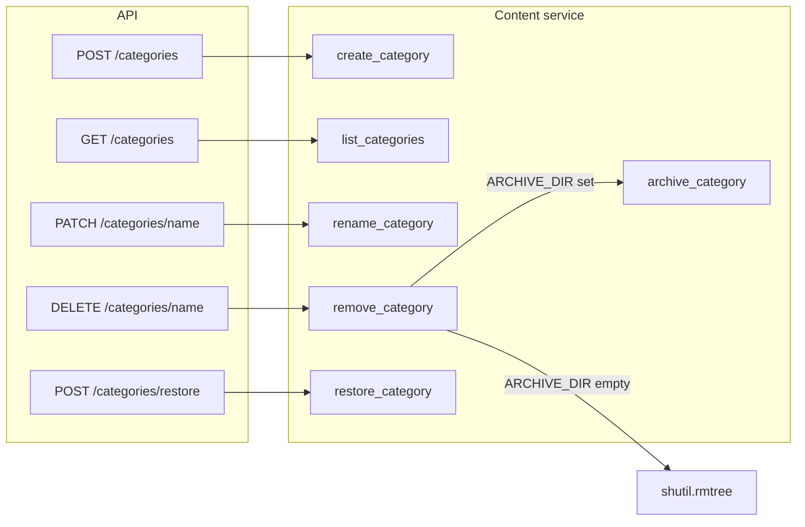

# Category operations plan

## Current state

- **Content service** ([backend/src/core/content_service.py](backend/src/core/content_service.py)): `list_categories()` (content root only), `category_details()`, `create_object()`, `archive_category()`, `restore_category()`. Archive uses `ARCHIVE_DIR` and renames to `{category_name}_{unix_timestamp}`.
- **Config** ([backend/src/core/config.py](backend/src/core/config.py)): `CONTENT_DIR`, `ARCHIVE_DIR` (default `"../archive"`), `SUPPORTED_LANGUAGES`.
- **API** ([backend/src/api/v1/routes_content.py](backend/src/api/v1/routes_content.py)): only `list_categories`, `category_details`, `create_object` are exposed; archive/restore are not.
- **CLI** ([cli/src/kiddo_cli/commands/content.py](cli/src/kiddo_cli/commands/content.py)): same three commands; no archive/restore/create-category/rename/remove.

No existing icon/image generation in the backend. TTS follows [existing_scripts/generate.py](existing_scripts/generate.py) (ported in [backend/src/core/tts.py](backend/src/core/tts.py): same `VOICE = "alloy"`, `MODEL = "tts-1-hd"`). Translation in [backend/src/core/translation.py](backend/src/core/translation.py).

---

## 1. Create category

**Behavior:** Create folder under Content, generate category-level voice files for supported languages, generate a simple category icon (cheapest model).

**Voice generation (align with existing_scripts/generate.py):**

- Use the same logic as [existing_scripts/generate.py](existing_scripts/generate.py): same TTS model and voice already used in [backend/src/core/tts.py](backend/src/core/tts.py) (`tts-1-hd`, `alloy`). For category creation (and rename), call `generate_audio(label, lang)` once per language and write to `category_{lang}.mp3` in the category folder — i.e. one “word” (the category label) per language, mirroring how generate.py generates one file per word per lang. No change to tts.py required.

**Service (content_service.py):**

- Add `create_category(category_name: str)`.
  - Validate `category_name` with `_is_safe_category_name`; reject if category folder already exists.
  - Create directory `_content_root() / category_name`.
  - **Voices:** For each language in `SUPPORTED_LANGUAGES`, get label (English: `category_name`; others: `translate_word(category_name, lang, category_name)`), then `generate_audio(label, lang)` and write to `cat_path / f"category_{lang}.mp3"` (same pattern as generate.py: one output file per “word” per lang).
  - **Icon:** Call a new icon-generation helper with prompt derived from `category_name` and save as `cat_path / "category_icon.png"`.
  - Return a result dict (e.g. `category`, `message`, or `error`).

**Image/icon generation (same style as generate.py):**

- Add a backend module (e.g. [backend/src/core/icon.py](backend/src/core/icon.py)) that **mirrors the structure** of [existing_scripts/generate.py](existing_scripts/generate.py) and [backend/src/core/tts.py](backend/src/core/tts.py):
  - Top: config (model, size) and OpenAI client from `settings.OPENAI_API_KEY`.
  - Single public function, e.g. `generate_icon(prompt: str) -> bytes`, that calls the OpenAI Images API and returns PNG bytes.
  - Use the **cheapest model** (e.g. **DALL-E 2** at 256x256) and a short, child-friendly prompt derived from the category name.
  - Same error-handling pattern as tts.py: raise or return cleanly if `OPENAI_API_KEY` is missing; handle API errors.
  - No separate script in `existing_scripts` unless you add one later; the backend module is the integration point, structured like the TTS module.

**API:** `POST /content/categories` with body `{"name": "<category_name>"}`.  
**CLI:** New command e.g. `create-category --name <category_name>`.

---

## 2. Remove category

**Behavior:** If `ARCHIVE_DIR` is set (non-empty after strip), use existing `archive_category`; otherwise delete the category folder permanently. Do **not** change `archive_category` logic.

**Service (content_service.py):**

- Add `remove_category(category_name: str) -> dict[str, Any]`:
  - Validate name and that category exists in content (same checks as `archive_category`).
  - If `settings.ARCHIVE_DIR` and `settings.ARCHIVE_DIR.strip()`:
    - Call `archive_category(category_name)` and return its result.
  - Else:
    - Permanently delete the category directory (e.g. `shutil.rmtree(cat_path)`) and return a result dict indicating permanent deletion.

**API:** `DELETE /content/categories/{category_name}`.  
**CLI:** New command e.g. `remove-category <name>`.

---

## 3. Rename category

**Behavior:** Rename the content folder and regenerate category-level voice files (no icon regeneration).

**Service (content_service.py):**

- Add `rename_category(old_name: str, new_name: str) -> dict[str, Any]`:
  - Validate both names with `_is_safe_category_name`; ensure `old_name` exists and `new_name` does not.
  - Rename folder: `shutil.move(old_path, new_path)` (or equivalent).
  - Regenerate category voice files for the new name: same approach as in `create_category` (translate + TTS per language), writing `category_{lang}.mp3` in the renamed folder. Optionally keep or update `category_icon.png` (no regeneration per your spec).

**API:** `PATCH /content/categories/{category_name}` with body `{"name": "<new_name>"}`.  
**CLI:** New command e.g. `rename-category <old_name> --to <new_name>`.

---

## 4. List categories (including deleted/archived)

**Behavior:** Support query parameters to include or list only archived (deleted) categories.

**Service (content_service.py):**

- Extend `list_categories(include_archived: bool = False, archived_only: bool = False) -> dict[str, Any]`:
  - If `archived_only`: list only from archive. Scan `_archive_root()`, parse folder names matching `{base}_{digits}`, return e.g. `{"categories": [], "archived": [{"base_name": "foods", "archive_folder": "foods_1738...", "archived_at": 1738...}]}`.
  - If `include_archived`: return current content categories as today, plus an `"archived"` key with the same list of archived entries.
  - Otherwise: keep current behavior (only content categories, no `archived` key).
  - If archive directory does not exist or `ARCHIVE_DIR` is empty, `archived` is empty list.

**API:** `GET /content/categories?include_archived=true` and `?archived_only=true`.  
**CLI:** Add options to existing `categories` command, e.g. `--include-archived`, `--archived-only`.

---

## 5. Restore deleted category

**Behavior:** Use existing `restore_category` without changing its logic; only expose it.

**Service:** No change; keep [restore_category](backend/src/core/content_service.py) as is (restores by base name or exact `name_timestamp`).

**API:** e.g. `POST /content/categories/restore` with body `{"name": "<category_name_or_archive_folder>"}`.  
**CLI:** New command e.g. `restore-category <name>`.

---

## 6. Implementation order and files

| Step | What                                                       | Files to touch                                                 |
| ---- | ---------------------------------------------------------- | -------------------------------------------------------------- |
| 1    | Icon module (same pattern as generate.py/tts.py; DALL-E 2) | New `backend/src/core/icon.py`; optional config for model/size |
| 2    | Create category (folder + voices + icon)                   | `content_service.py`, `routes_content.py`, CLI `content.py`    |
| 3    | Remove category (wrapper)                                  | `content_service.py`, `routes_content.py`, CLI                 |
| 4    | Rename category                                            | `content_service.py`, `routes_content.py`, CLI                 |
| 5    | List categories params                                     | `content_service.py`, `routes_content.py`, CLI                 |
| 6    | Restore (expose only)                                      | `routes_content.py`, CLI                                       |

---

## 7. Config / env

- Treat **empty** `ARCHIVE_DIR` as “archive disabled” for remove (delete permanently). Current default is `"../archive"`; no change required if env is set. If you want “not set” to mean “delete only”, document that setting `ARCHIVE_DIR=` (empty) disables archiving.

---

## 8. Diagram (high-level flow)

---

## 9. Open points

- **Icon model:** Use **DALL-E 2** (e.g. 256x256) for lowest cost; module structure follows [existing_scripts/generate.py](existing_scripts/generate.py) / [backend/src/core/tts.py](backend/src/core/tts.py).
- **Category name only:** Create/rename always use `category_name` for TTS and icon prompt (e.g. replace underscores with spaces, title-case, for the icon prompt).

