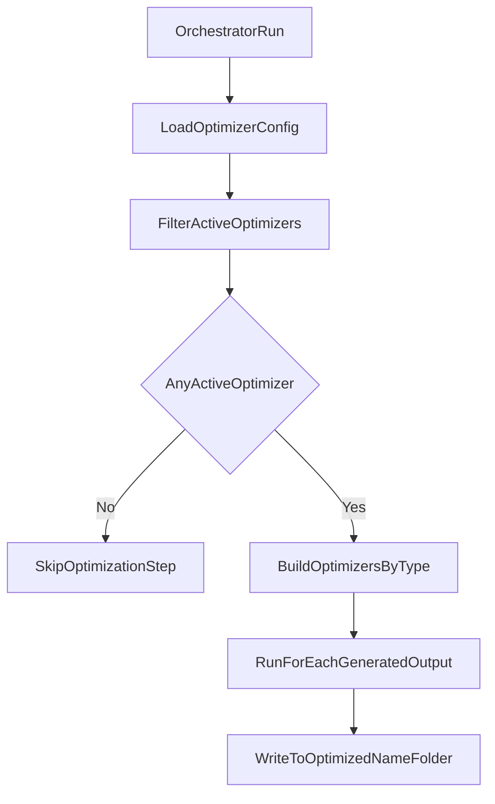

# Optimizer Services Integration Plan

## Goal

Create a backend-native optimizer service layer that adapts `mp3-optimize` behavior and follows translation-style service organization. Optimizers are configured as a list, each with unique `name`, implementation `type`, `active` flag, and params. Orchestrator runs active optimizers per generated output and skips the stage if none are active.

## Reference Architecture To Mirror

- Translation abstractions and construction flow in `[/home/spyder/_Proj/Python/mx-admin/backend/src/services/translation/base.py](/home/spyder/_Proj/Python/mx-admin/backend/src/services/translation/base.py)` and `[/home/spyder/_Proj/Python/mx-admin/backend/src/services/translation/__init__.py](/home/spyder/_Proj/Python/mx-admin/backend/src/services/translation/__init__.py)`
- Shared config/dataclass patterns in `[/home/spyder/_Proj/Python/mx-admin/backend/src/services/models.py](/home/spyder/_Proj/Python/mx-admin/backend/src/services/models.py)` and loader patterns in `[/home/spyder/_Proj/Python/mx-admin/backend/src/services/config_loader.py](/home/spyder/_Proj/Python/mx-admin/backend/src/services/config_loader.py)`
- Pipeline integration point in `[/home/spyder/_Proj/Python/mx-admin/backend/src/services/orchestrator.py](/home/spyder/_Proj/Python/mx-admin/backend/src/services/orchestrator.py)`
- Source optimization logic to adapt from `[/home/spyder/_Proj/Python/mp3-optimize/audio_optimizer.py](/home/spyder/_Proj/Python/mp3-optimize/audio_optimizer.py)`
- Parameter reference config in `[/home/spyder/_Proj/Python/mp3-optimize/config.json](/home/spyder/_Proj/Python/mp3-optimize/config.json)`

## Proposed Module Organization

- New package: `[/home/spyder/_Proj/Python/mx-admin/backend/src/services/optimization](/home/spyder/_Proj/Python/mx-admin/backend/src/services/optimization)`
  - `base.py`: abstract optimizer base class (`AudioOptimizerBase`) aligned with translation/provider patterns.
  - `ffmpeg_optimizer.py`: ffmpeg implementation adapted from `AudioOptimizer.optimize_with_ffmpeg`.
  - `pydub_optimizer.py`: pydub implementation adapted from `AudioOptimizer.optimize_with_pydub`.
  - `__init__.py`: `build_optimizer(...)`, `build_active_optimizers(...)`, and package exports.

## Data/Config Model Changes

- Extend `[/home/spyder/_Proj/Python/mx-admin/backend/src/services/models.py](/home/spyder/_Proj/Python/mx-admin/backend/src/services/models.py)` with `OptimizerConfig` dataclass:
  - `name: str` (unique optimizer instance name, e.g. `voice_fast`)
  - `type: str` (optimizer implementation type, e.g. `ffmpeg`, `pydub`)
  - `active: bool`
  - `params: dict[str, Any]` (`sample_rate`, `mono`, `vbr_quality`, plus optional future params)
  - `config_path: Path` for traceability/logging
- Extend `[/home/spyder/_Proj/Python/mx-admin/backend/src/services/config_loader.py](/home/spyder/_Proj/Python/mx-admin/backend/src/services/config_loader.py)` with `load_optimizer_configs(...)` that:
  - parses a list of optimizers
  - validates unique `name`
  - merges missing params with defaults derived from `mp3-optimize/config.json`
  - supports legacy flat params where practical during transition

## Runtime Flow (List of Active Optimizers)

## Integration Steps

- Add optimizer stage into orchestrator flow after generation, invoked centrally in `orchestrator.py`.
- For each generated item produced from configs in `backend/config/generators/`, run each active optimizer.
- Do not invoke optimizer logic directly from generator/provider implementations.
- Ensure optimizer methods return structured outcomes or raise clear exceptions (no `print`-driven control flow).
- Reuse backend logging (`get_logger`) for optimizer operations and failures.
- Keep CLI concerns out of backend services (do not carry `argparse` behavior from `mp3-optimize`).

## Contract Design

- Base class method (async for consistency with services stack):
  - `optimize(input_path: Path, output_path: Path | None = None) -> Path`
- Factory behavior:
  - `build_optimizer(config: OptimizerConfig, base_dir: Path) -> AudioOptimizerBase`
  - Reject unknown optimizer `type` values with explicit `ValueError`.
- Optimizer execution behavior:
  - use `name` only as instance identity/output folder discriminator
  - use `type` to choose implementation class
  - skip entire optimization stage when active optimizer list is empty

## Migration Notes from mp3-optimize

- Copy/adapt only core optimization logic (ffmpeg args construction, pydub processing).
- Replace print-based status/error handling with exceptions + structured logging.
- Use `mp3-optimize/config.json` parameter defaults as the baseline and extend parameters only when needed by backend flow.

## Output Folder Strategy

- Preserve the generator output hierarchy beneath a per-optimizer root folder:
  - `.../optimized_{optimizer_name}/<existing_generator_relative_path>/...`
- This keeps output comparable across generators while isolating results by optimizer instance.

## Documentation Updates (Required)

- Update `[/home/spyder/_Proj/Python/mx-admin/backend/README.md](/home/spyder/_Proj/Python/mx-admin/backend/README.md)`:
  - New optimizer service concept and orchestrator-only invocation point.
  - Config examples with list schema (`name`, `type`, `active`, `params`).
  - Clarify `name` vs `type` semantics and behavior when no optimizer is active.
  - Output folder examples showing `optimized_{optimizer_name}` hierarchy.
  - Any dependency/setup notes (`pydub`, ffmpeg availability).
- If new dependency is introduced in backend, update `[/home/spyder/_Proj/Python/mx-admin/backend/requirements.txt](/home/spyder/_Proj/Python/mx-admin/backend/requirements.txt)`.

## Validation Plan

- Unit test factory selection by optimizer `type` (`ffmpeg`/`pydub`/unknown).
- Unit test config parsing for list input, unique-name validation, and defaults merge.
- Integration test that orchestrator invokes optimizers per generated file from generator configs.
- Integration test skip behavior when all optimizers are inactive.
- Integration test output path generation for `optimized_{optimizer_name}` hierarchy.
- Smoke test with ffmpeg path and verify output file exists and is usable.
