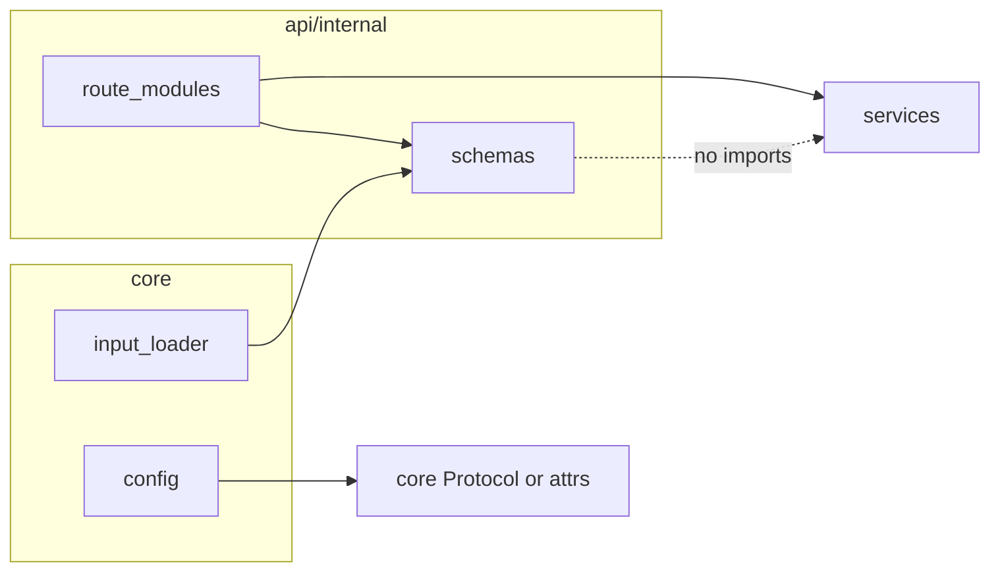

# Internal OpenAPI schemas and HTTP boundary cleanup

## Goals

- Treat **Pydantic models under** [`src/api/internal/schemas/`](src/api/internal/schemas/) as the **HTTP contract** (what OpenAPI documents and what `core` can depend on for pipeline payloads).
- Keep **`schemas/` free of `src.services` imports** so the contract layer does not point inward at implementations.
- Remove **`core` → `services`** imports ([`input_loader.py`](src/core/input_loader.py), [`config.py`](src/core/config.py), [`pipeline.py`](src/core/pipeline.py)) while preserving behavior.

## Dependency direction (intended)

**Note:** `core` importing `src.api.internal.schemas` is a deliberate tradeoff you chose (schemas live next to routes). Those modules must stay **Pydantic-only** (plus stdlib/typing) to avoid import cycles and keep layering predictable. If you later want stricter layering (`core` must not depend on `api`), duplicate a slim dataclass in [`src/core/models.py`](src/core/models.py) with the same fields as `GenerateRequest` and map once at the HTTP client call site.

## Schema package layout

Add [`src/api/internal/schemas/__init__.py`](src/api/internal/schemas/__init__.py) (optional re-exports) and split models by domain:

| Module | Move from / define |
|--------|---------------------|
| [`schemas/tts.py`](src/api/internal/schemas/tts.py) | `GenerateRequest`, `GenerateWordRequest` from [`text_to_speech_routes.py`](src/api/internal/text_to_speech_routes.py). Optionally add `TtsGenerateResult` mirroring the `dict` returned by `generate_single` and set `response_model=` for richer OpenAPI (recommended if you want codegen-friendly responses). |
| [`schemas/translation.py`](src/api/internal/schemas/translation.py) | `TranslateRequest`, `TranslateFileResponse` from [`text_translation_routes.py`](src/api/internal/text_translation_routes.py). Add **Pydantic** `LangCodeText` (new name e.g. `LangCodeText` in schemas, or `LangCodeTextPayload` to avoid confusion with [`src/services/models.py`](src/services/models.py) dataclass). Replace `TranslateResponse.lang_text: LangCodeText` (service type) with the Pydantic type. |
| [`schemas/evaluation.py`](src/api/internal/schemas/evaluation.py) | `EvaluateRequest` from [`evaluators_routes.py`](src/api/internal/evaluators_routes.py). |
| [`schemas/optimization.py`](src/api/internal/schemas/optimization.py) | `OptimizeRequest` from [`optimizers_routes.py`](src/api/internal/optimizers_routes.py). |
| [`schemas/jobs.py`](src/api/internal/schemas/jobs.py) | `GenerateResponse`, `JobStatusResponse` from [`jobs_routes.py`](src/api/internal/jobs_routes.py) (consider renaming to job-specific names in the schema module to avoid ambiguity with TTS). |
| [`schemas/service_config.py`](src/api/internal/schemas/service_config.py) | `ApplyConfigRequest`, `ApplyConfigResponse` from [`service_config_routes.py`](src/api/internal/service_config_routes.py). |

Each route file: **delete inline `BaseModel` classes**, `from src.api.internal.schemas... import ...`, keep handlers and service wiring unchanged aside from mapping.

## Behavioral alignment: `request_id`

Today [`text_to_speech_routes.generate_single`](src/api/internal/text_to_speech_routes.py) **always** builds `request_id` as `api-{row}-{col}-{lang}` and ignores the id produced by [`input_loader`](src/core/input_loader.py). The commented pipeline in [`pipeline.py`](src/core/pipeline.py) posts fields that match `GenerateRequest` but never sent `request_id`.

**Plan:** Add optional `request_id: str | None = None` to `GenerateRequest`. In `generate_single`, use `body.request_id or f"api-{body.row_index}-{body.column_index or 0}-{body.language_code}"` so file-driven pipeline rows keep stable ids. `generate_word` can stay as-is (still constructs `TTSRequest` locally).

## `core` changes

1. **[`input_loader.py`](src/core/input_loader.py)**  
   - Import `GenerateRequest` from `src.api.internal.schemas.tts` (or package `__init__`).  
   - Return `list[GenerateRequest]` (or build instances with `.model_validate`/constructor).  
   - Map fields so `request_id` is populated (same string logic as today’s `TTSRequest` construction).

2. **[`config.py`](src/core/config.py)**  
   - Remove `TYPE_CHECKING` import of `TTSRequest`.  
   - Change [`build_output_stem`](src/core/config.py) to accept a **`typing.Protocol`** (e.g. `OutputStemSource`) with `filename_text`, `language_code`, `text`, `request_id` — satisfied by both `GenerateRequest` instances and service `TTSRequest` (providers still use `TTSRequest`).

3. **[`pipeline.py`](src/core/pipeline.py)**  
   - Remove unused `src.services` imports.  
   - When/if pipeline code is uncommented, type hints should use `GenerateRequest` from schemas (or the Protocol) instead of `TTSRequest`.

4. **[`text_to_speech/models.py`](src/services/text_to_speech/models.py)**  
   - `build_output_path` calls `settings.build_output_stem(request)` — unchanged if `TTSRequest` still matches the Protocol.

## Translation route mapping

In [`text_translation_routes.py`](src/api/internal/text_translation_routes.py):

- Stop importing `LangCodeText` from `src.services.models` for API models.  
- Build Pydantic `LangCodeText` for `TranslateResponse` from service `TranslateResult` / normalized codes (keep using `normalize_language_code` as today).  
- Service layer keeps using the dataclass [`LangCodeText`](src/services/models.py) internally; only the **HTTP response** uses the schema type.

## Tests and docs

- Update [`test_text_translation_routes.py`](src/api/internal/__tests__/unit/test_text_translation_routes.py) to construct/compare **Pydantic** `LangCodeText` (or dict equality on `response.json()`).  
- Update [`test_text_to_speech_service.py`](src/api/internal/__tests__/unit/test_text_to_speech_service.py) imports if it references moved request models.  
- Run **Pylint** on touched Python files per project rules.  
- If [`README.md`](README.md) (repo root or backend) documents internal API shapes or file layout, add a short note that internal request/response models live under `src/api/internal/schemas/` and drive OpenAPI.

## Non-goals (this pass)

- Moving `TTSRequest` out of `services` (providers still need a stable in-process type).  
- Generating Python clients from OpenAPI (optional follow-up: export `/openapi.json` and add codegen in CI).  
- Refactoring [`evaluators_routes`](src/api/internal/evaluators_routes.py) lazy import of `config_loader` (separate concern).
