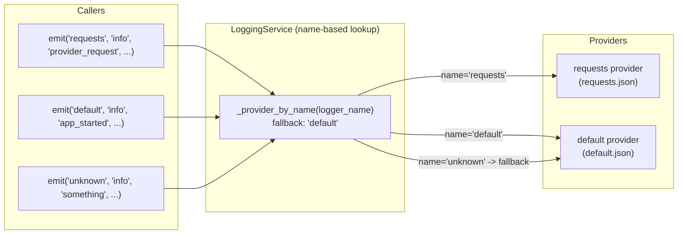

# Logging Config Restructure

## Problem

1. Two config files for the same `struct_log` provider have completely different JSON structures:
   - `default.json` nests under `config.logging` (a full `dictConfig` blob with `version`, `root`, etc.)
   - `requests.json` uses a flat `config.request_log` with unrelated shape
2. `LoggingService._active()` routes all runtime calls to one provider, making the other provider's
   config invisible at runtime.

## Design: Name-Based Provider Routing

Remove `_active()`. Instead, `LoggingService.emit(logger_name, ...)` looks up the provider whose
**name** (config file stem) matches `logger_name`. If no match, fall back to the provider named `"default"`.



At startup, `LoggingService.configure()` still calls `configure()` on **each** active provider.
Each provider calls `dictConfig` independently; with `disable_existing_loggers: false` (auto-injected),
the calls are additive. Both sets of handlers coexist in the stdlib logging system.

## New Config Shape (both files)

Top-level `config` keys -- all optional except `handlers`:

- **`formatters`** -- Python logging formatter definitions
- **`handlers`** -- Handler definitions (custom `active` flag; stripped before dictConfig)
- **`loggers`** -- Named stdlib logger definitions (e.g. `requests` with `propagate: false`)
- **`structlog`** -- structlog renderer config (only in `default.json`)
- **`request_log`** -- Request event field toggles (only in `requests.json`)

The provider auto-injects `version: 1` and `disable_existing_loggers: false`.
Active handlers **not** assigned to any named logger in `loggers` are auto-added to `root.handlers`.

### `default.json` (after)

```json
{
  "service_provider": {
    "service": "logging",
    "provider": "struct_log",
    "enabled": true,
    "priority": 2,
    "version": "1.0",
    "config": {
      "formatters": {
        "plain": {
          "format": "%(message)s"
        }
      },
      "handlers": {
        "console": {
          "class": "logging.StreamHandler",
          "level": "INFO",
          "formatter": "plain",
          "stream": "ext://sys.stdout"
        },
        "file": {
          "class": "logging.FileHandler",
          "level": "INFO",
          "formatter": "plain",
          "filename": "${output_dir}/results/logs/app.log",
          "encoding": "utf-8"
        },
        "seq": {
          "active": false,
          "class": "seqlog.structured_logging.SeqLogHandler",
          "level": "INFO",
          "server_url": "http://localhost:5341",
          "api_key": ""
        }
      },
      "structlog": {
        "renderer": "console"
      }
    }
  }
}
```

No `root` section. `console` and `file` are active (no `active` key = true by default) and not
referenced by any named logger, so the provider auto-adds them to `root.handlers`.
`seq` has `active: false`, so it is removed before dictConfig.

### `requests.json` (after)

```json
{
  "service_provider": {
    "service": "logging",
    "provider": "struct_log",
    "enabled": true,
    "priority": 1,
    "version": "1.0",
    "config": {
      "formatters": {
        "plain": {
          "format": "%(message)s"
        }
      },
      "handlers": {
        "requests_file": {
          "class": "logging.handlers.RotatingFileHandler",
          "level": "INFO",
          "formatter": "plain",
          "filename": "${output_dir}/results/requests.log",
          "maxBytes": 10485760,
          "backupCount": 5
        }
      },
      "loggers": {
        "requests": {
          "handlers": ["requests_file"],
          "level": "INFO",
          "propagate": false
        }
      },
      "request_log": {
        "fields": {
          "provider": true,
          "translator": true,
          "model": true,
          "actor": true,
          "voice_id": true,
          "language": true,
          "input": true,
          "response_duration": true,
          "timestamp": true
        }
      }
    }
  }
}
```

`requests_file` is referenced by the `requests` named logger, so it does **not** go to root.
The named logger `requests` has `propagate: false` so request events stay in `requests.log` only.

## Code Changes

### 1. `LoggingService` -- replace `_active()` with name-based lookup

File: [`src/services/logging/service.py`](backend/src/services/logging/service.py)

- Remove `_active()`
- Add `_provider_by_name(name) -> LoggingServiceProvider | None` -- lookup in `self._providers`
  by matching `provider.name == name` (only among active providers)
- **`emit(logger_name, level, event, **fields)`**:
  1. `provider = self._provider_by_name(logger_name)`
  2. If not found: `provider = self._provider_by_name("default")`
  3. If still not found: first active provider (safety fallback)
  4. `provider.emit(logger_name, level, event, **fields)`
- **`get_logger(name)`** -- same routing as `emit`
- **`bind_request_id()`** -- iterate all active providers (structlog context is global)
- **`clear_request_context()`** -- iterate all active providers
- **`log_to_all_active_loggers()`** -- iterate all active providers

### 2. `StructLogProvider.configure()` -- read new flat keys

File: [`src/services/logging/providers/struct_log.py`](backend/src/services/logging/providers/struct_log.py)

**configure()** changes:
- Read `formatters`, `handlers`, `loggers` directly from `self.config` (not `self.config.get("logging")`)
- Build dictConfig dict internally:
  - Inject `version: 1`, `disable_existing_loggers: false`
  - Process `active` flags (existing `_disable_inactive_handlers`)
  - Resolve file paths (existing helpers)
  - Check Seq availability (existing helper)
  - Auto-build `root`: collect active handler names, subtract those in `loggers.*.handlers`,
    put remainder in `root.handlers` with `level: INFO`
  - If no unassigned handlers remain, omit `root`
- Call `dictConfig(prepared)` only if there are handlers
- Keep `structlog` and `request_log` section handling as-is

**emit()** changes:
- Remove the `logger_name == "request_logger"` check
- Apply field filtering based on **event type** (`provider_request` / `translator_request`)
  when `self._request_fields` has been populated (i.e. config has `request_log.fields`)
- Remove the `_structlog is None` special return branch for requests -- just use the
  normal `self.get_logger(logger_name)` path for all cases

**Remove:**
- `_ensure_requests_handler` -- the request handler is now explicit in `requests.json`
- `_requests_logger` instance variable -- no longer needed

**Keep unchanged:**
- `_disable_inactive_handlers`, `_disable_unavailable_seq_handlers`
- `_remove_handler_references` (adapted: strip from `loggers.*.handlers` too, not just `root`)
- `_normalize_file_handler_paths`, `_resolve_file_handler_paths`
- `_apply_request_log_config`, `_configure_structlog`
- `get_logger`, `bind_request_id`, `clear_request_context`, `log_to_all_active_loggers`

### 3. Update callers -- `"request_logger"` to `"requests"`

**[`src/api/internal/logging_routes.py`](backend/src/api/internal/logging_routes.py):**
- Line 127-128: `service.emit("request_logger", ...)` -> `service.emit("requests", ...)`
- Line 155-156: `service.emit("request_logger", ...)` -> `service.emit("requests", ...)`
- Line 103: already uses `"requests"` -- no change

**[`src/core/log_client.py`](backend/src/core/log_client.py):**
- Line 80: `logger_name="request_logger"` -> `logger_name="requests"`
- Line 95: `logger_name="request_logger"` -> `logger_name="requests"`

### 4. README update

Update logging config section in [`README.md`](backend/README.md) to reflect:
- New config shape (formatters/handlers/loggers)
- Name-based routing (`logger_name` = config file name)
- Removed `root` section (auto-built from unassigned handlers)
