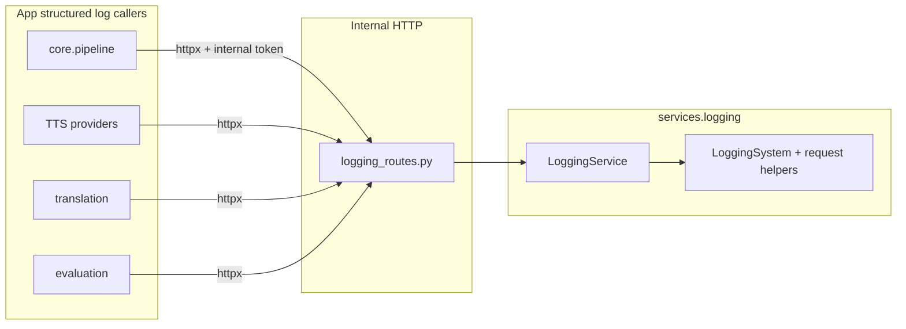

# Logging service reorganization

## Current state

- Implementation lives in [`src/core/logging/`](src/core/logging/) (`logging_system.py`, `request_logger.py`); [`src/services/logging/`](src/services/logging/) is mostly **re-export shims** and a stub [`LoggingService`](src/services/logging/service.py).
- Startup in [`src/main.py`](src/main.py) builds [`LoggingSystem`](src/core/logging/logging_system.py) from [`config/loggers/`](config/loggers/) (directory merge: each `*.json` becomes a top-level key `stem → object`, then `_split_config` pulls `logging`, `structlog`, `request_logger`).
- Call sites today: [`src/core/pipeline.py`](src/core/pipeline.py) (`get_logger`), TTS/evaluation (`log_provider_request` via [`src/services/logging`](src/services/logging)), translation ([`openai_translate.py`](src/services/text_translation/providers/openai_translate.py) uses `log_translator_request` from `core`).
- **No** [`logging_routes.py`](src/api/internal/) exists yet; internal routers are registered in [`src/main.py`](src/main.py) and listed in [`src/api/internal/__init__.py`](src/api/internal/__init__.py).
- [`LoggingService`](src/services/logging/service.py) is **not** registered in [`ServiceRegistry`](src/services/service_registry.py) (no `SERVICE_CLASS` in logging package), which is fine: logging is infrastructure with **no provider JSONs** like TTS—mirror **file layout** of `text_translation`, not necessarily `SERVICE_ACCEPT_CRITERIA` / `config_subdir` loading.

## Target architecture

- **Route handlers** call `LoggingService` **in-process** (no recursive HTTP) to emit to stdlib/structlog.
- **Structured application logs** (your chosen scope): emit via **HTTP** to `/internal/...` so [`http-boundary.mdc`](.cursor/rules/http-boundary.mdc) stays satisfied for `core` → services and service → service.
- **Bootstrap / uvicorn / generic `logging.info` in `main.py`**: keep plain stdlib logging (out of scope per your answer).

## 1. Move implementation into `services/logging`

- **Move** (not duplicate) the bodies of:
  - [`src/core/logging/logging_system.py`](src/core/logging/logging_system.py) → [`src/services/logging/logging_system.py`](src/services/logging/logging_system.py) (replace shim).
  - [`src/core/logging/request_logger.py`](src/core/logging/request_logger.py) → [`src/services/logging/request_logger.py`](src/services/logging/request_logger.py) (replace shim).
- **Imports**: `request_logger` may keep using [`src.core.config.settings`](src/core/config.py) (same as today); avoid importing other `services/*` from logging internals.
- **Delete** [`src/core/logging/`](src/core/logging/) once nothing references it.

## 2. Package shape aligned with `text_translation`

| Piece | Role |
|--------|------|
| [`models.py`](src/services/logging/models.py) | Pydantic (or dataclass) API models, e.g. `LogEmitRequest` with `logger_name: str`, `level: str`, `event: str`, `fields: dict[str, Any]` (arbitrary structured kwargs). Optional dedicated bodies for provider/translator request logs if you want stricter OpenAPI. |
| [`service.py`](src/services/logging/service.py) | `LoggingService` methods: `emit(logger_name, level, event, **fields)`, wrappers for provider/translator request logging that build the same payloads as today’s `log_provider_request` / `log_translator_request`. Implement `replace_providers` / `providers_snapshot` as **no-op** returning `[]` if you keep inheriting [`Service`](src/services/models.py) (registry may stay unaware of logging). |
| [`logging_system.py`](src/services/logging/logging_system.py) | Unchanged behavior for file/Seq/console setup; small extensions below. |
| [`__init__.py`](src/services/logging/__init__.py) | Export stable public names (`LoggingSystem`, `get_logger`, context helpers, etc.) from the new canonical modules—**stop** re-exporting from `core`. |

Remove obsolete shim-only files if everything imports from canonical modules.

## 3. One config file → one logical logger name (`stem`)

**Goal:** every `config/loggers/<name>.json` corresponds to a **first-class logger channel** `<name>` used by the API’s `logger_name`.

Concrete behavior (backward-compatible migration path):

- **`logging.json`** (dictConfig with `version`): keep applying `dictConfig` for handlers/root as today. **Additionally**, ensure a named logger whose name is the file stem exists for API routing, e.g. **`logging`**: either (a) add a `loggers.logging` entry in JSON duplicating root’s handlers, or (b) after `dictConfig`, programmatically attach the same handler set as root to `logging.getLogger("logging")`. Document the chosen approach in README.
- **`structlog.json`**: no stdlib logger; continue **global** `structlog.configure(...)`. For API emits, use `structlog.get_logger(logger_name)` when structlog is installed (same pattern as current `get_logger`), else fall back to `logging.getLogger(logger_name)`.
- **`request_logger.json`**: keep path/fields behavior in [`configure_request_logger`](src/core/logging/request_logger.py) (moved). Change the **stdlib logger name** from hard-coded `services.requests` to **`request_logger`** (matches stem). Update [`_ensure_requests_handler`](src/core/logging/logging_system.py) (moved) to create/configure **`request_logger`** instead of `services.requests`, and adjust any `log_to_all_active_loggers` exclusions accordingly.

## 4. New internal routes: `logging_routes.py`

- Add [`src/api/internal/logging_routes.py`](src/api/internal/logging_routes.py):
  - Prefix `/internal`, tag e.g. `internal-logging`.
  - Auth: same as other internal routes (`Depends(require_internal)`).
  - **POST** endpoint(s), e.g. `/internal/logging/emit` with body `{ "logger_name", "level", "event", "fields" }` — mirrors structlog-style `logger.info("event", **fields)` with an explicit `logger_name`.
  - Optional: dedicated POSTs for provider/translator payloads (thin wrappers calling the same service methods) to preserve type-safe OpenAPI for existing callers.
- Register router in [`src/main.py`](src/main.py) and export in [`src/api/internal/__init__.py`](src/api/internal/__init__.py).
- **Dependency**: resolve `LoggingService` from `app.state` (set during lifespan alongside or instead of raw `LoggingSystem`—see next section).

## 5. Lifespan / wiring

- In [`src/main.py`](src/main.py): import `LoggingSystem` from `src.services.logging` (or submodule). After `configure()`, construct `LoggingService(...)` and store on `app.state` (e.g. `app.state.logging_service`) for route injection.
- Consider keeping `app.state.logging_system` for backward compatibility or replace it with the service only—pick one and update any references (grep for `logging_system`).

## 6. Callers: HTTP for structured logs

- **`core/pipeline.py`**: remove `from src.core.logging import get_logger`. Add a small **HTTP-only** helper under `src/core/` (e.g. `log_client.py`) that posts to `/internal/logging/emit` using existing pipeline pattern for `httpx`, `BACKEND_URL` / base URL, and `internal_token` (same as other internal calls). Use `logger_name="logging"` or `"pipeline"` as you standardize in config/README.
- **TTS / evaluation / translation**: replace direct `log_provider_request` / `log_translator_request` imports with HTTP calls to the new routes (or a shared async helper in each module). Pass `logger_name="request_logger"` and `event`/`fields` equivalent to current payloads.
- **Services** may share one internal async client factory if one already exists in pipeline/core; avoid importing `LoggingService` from `core`.

## 7. Docs and quality

- Update [backend README](README.md) (and root if it duplicates logging setup): new internal endpoints, `logger_name` convention tied to `config/loggers/*.json` stems, migration note for `services.requests` → `request_logger`.
- Run **pylint** on all touched `*.py` files and fix issues.

## Risks / notes

- **Performance**: HTTP per log line is heavier than in-process; acceptable for structured provider/translator logs; if pipeline logging becomes hot again when uncommented, consider a future batch endpoint (out of scope unless you ask).
- **Tests**: add or adjust any tests that imported `src.core.logging` (grep after edits).
