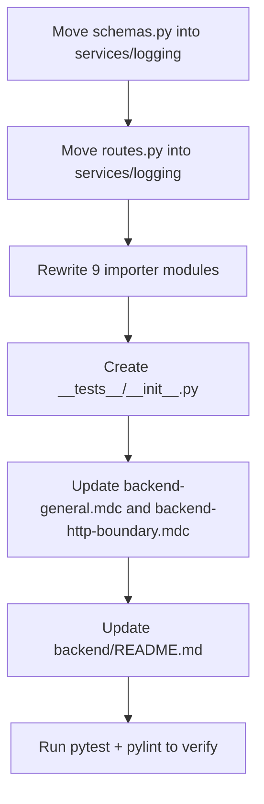

## Target layout

```
src/services/logging/
  __init__.py            # unchanged descriptor (SERVICE_CLASS / SERVICE_NAME / SERVICE_ACCEPT_CRITERIA)
  service.py             # unchanged
  models.py              # unchanged (LoggingServiceProvider base only)
  schemas.py             # NEW - moved from src/api/internal/schemas/logging.py
  routes.py              # NEW - moved from src/api/internal/logging_routes.py
  providers/             # unchanged
  __tests__/             # NEW folder (empty placeholder; no existing logging tests)
    __init__.py
```

The `src/api/internal/` folder keeps the router-only pattern for the other services for now. `logging_routes.py` and `schemas/logging.py` are removed (no compat shim, per user direction that everything lives under `src/services/logging/`).

## File moves and edits

### 1. Move routes: [`src/api/internal/logging_routes.py`](backend/src/api/internal/logging_routes.py) -> `src/services/logging/routes.py`

- Delete the source file.
- Create `src/services/logging/routes.py` with identical router and path constants (`LOGGING_LOGGERS`, `LOGGING_EMIT`, `LOGGING_API_REQUEST`, `LOGGING_PROVIDER_REQUEST`, `LOGGING_TRANSLATOR_REQUEST`) and the same `/internal` prefix + `internal-logging` tag (HTTP contract unchanged).
- Rewrite the schema import from `src.api.internal.schemas.logging` to the co-located `src.services.logging.schemas`.

### 2. Move schemas: [`src/api/internal/schemas/logging.py`](backend/src/api/internal/schemas/logging.py) -> `src/services/logging/schemas.py`

- Delete the source file. Content moves verbatim (`LogLevel`, `StatusResponse`, `LogRequest`, `LogEmitRequest`, `LogApiRequest`, `LoggerInfo`, `LogProviderRequest`, `LogTranslatorRequest`).
- Update [`src/api/internal/schemas/__init__.py`](backend/src/api/internal/schemas/__init__.py) if it grows a re-export (currently it does not re-export logging schemas, so no change needed there).

### 3. Create `src/services/logging/__tests__/__init__.py`

- Empty marker so pytest discovers future logging tests alongside the service. No existing logging tests to move (confirmed via the `src/api/internal/__tests__/` listing).

### 4. Update every importer

- [`src/main.py`](backend/src/main.py) lines 12-20, 116:
  - Drop `logging_routes` from `from src.api.internal import (...)`.
  - Add `from src.services.logging import routes as logging_routes`.
  - Keep `app.include_router(logging_routes.router)` as-is so HTTP paths do not change.
- [`src/core/log_client.py`](backend/src/core/log_client.py) lines 16-23:
  - `from src.services.logging.routes import LOGGING_EMIT, LOGGING_API_REQUEST`
  - `from src.services.logging.schemas import LogEmitRequest, LogProviderRequest, LogTranslatorRequest, LogApiRequest, LogLevel`
- [`src/services/evaluation/engine.py`](backend/src/services/evaluation/engine.py) line 18: `from src.services.logging.schemas import LogProviderRequest`.
- [`src/services/text_translation/providers/openai_translate.py`](backend/src/services/text_translation/providers/openai_translate.py) line 11: `LogTranslatorRequest` -> `src.services.logging.schemas`.
- [`src/services/text_to_speech/providers/openai_tts.py`](backend/src/services/text_to_speech/providers/openai_tts.py), [`elevenlabs_tts.py`](backend/src/services/text_to_speech/providers/elevenlabs_tts.py), [`speaktor_tts.py`](backend/src/services/text_to_speech/providers/speaktor_tts.py), [`static_tts.py`](backend/src/services/text_to_speech/providers/static_tts.py): `LogProviderRequest` -> `src.services.logging.schemas`.

### 5. Preserve service discovery

No changes to [`src/services/service_registry.py`](backend/src/services/service_registry.py) or [`src/services/logging/__init__.py`](backend/src/services/logging/__init__.py). Discovery already walks `src.services.*` sub-packages and reads `SERVICE_CLASS` / `SERVICE_NAME` / `SERVICE_ACCEPT_CRITERIA`; that continues to work because only co-located files are added.

### 6. Update architecture rules (per user confirmation)

- [`.cursor/rules/backend-general.mdc`](.cursor/rules/backend-general.mdc):
  - Revise the "Layered Structure" section: services may host their own `routes.py` and `schemas.py` under `src/services/{name}/`; `src/api/` remains for cross-cutting routers (auth, v1 public routes) until other services are migrated.
  - Update "Structure" and "File & Naming Conventions" to list `routes.py`, `schemas.py`, `__tests__/` inside `services/{domain}/`.
  - Note the logging service as the reference example of the new layout.
- [`.cursor/rules/backend-http-boundary.mdc`](.cursor/rules/backend-http-boundary.mdc):
  - Keep the HTTP-boundary principle, but replace `src.api.internal.schemas` references with "each service's `schemas.py`" (or both during the transition) so the contract-import rule still makes sense.

### 7. Update [`backend/README.md`](backend/README.md)

- Lines 238-242 "Logging" table: change the linked path from `src/api/internal/logging_routes.py` to `src/services/logging/routes.py`.
- Lines 329, 337, 361 project-tree snippet: move `logging_routes.py` / `schemas/logging.py` into the `services/logging/` tree and remove from `api/internal/`.
- Lines 392-395 services/logging tree: add `routes.py`, `schemas.py`, `__tests__/`.
- Lines 569-704 "Logging" section: update file pointers (e.g., replace `src/services/logging/providers/struct_log.py` references remain valid; mention that HTTP contract now lives in `src/services/logging/routes.py` + `schemas.py`).

## Execution flow



## Verification

- Run `python -m pytest` (or existing test runner) to confirm imports still resolve.
- Run pylint on the touched files per [.cursor/rules/pylint-clean-python.mdc](backend/.cursor/rules/pylint-clean-python.mdc).
- Manual sanity: hit `/internal/logging/loggers` to confirm the router is still mounted and the registry loads `logging` from `config/logging/*.json` unchanged.

## Out of scope

- Migrating other services (`text_to_speech`, `text_translation`, `voice_optimization`, `evaluation`, `configuration`, `jobs`) - per user request, logging is the pilot.
- Renaming URL paths or changing the internal HTTP contract.