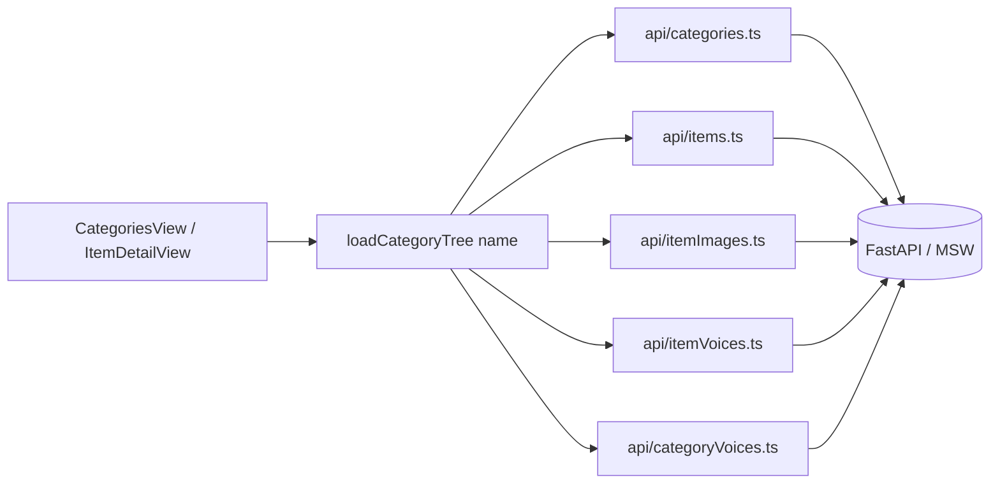

## Scope

Two-part change requested by the user:

1. Update [`src/data/mockData.ts`](src/data/mockData.ts) to match the new spec semantics.
2. Update frontend requests to use the new API.

Per the answers, we keep the rich UI tree (`Category` -> `Item` with file variants + voices) and rename `Image` -> `Item` throughout. The API client mirrors the OpenAPI spec 1:1; an aggregator builds the rich tree from multiple endpoints. MSW handlers slice the rich mock tree into per-endpoint responses.

Source of truth: [`backend/src/services/content/openapi.yaml`](../backend/src/services/content/openapi.yaml).

## Key spec deltas to absorb

- Items (not images) are the children of a category. File variants and voices are sub-resources of an item.
- `GET /content/categories` -> `{ categories: string[]; archived?: ArchivedEntry[]; error?: string }`.
- `GET /content/categories/{name}` -> `{ name; objects: string[]; images_names?: string[]; images_<lang>?: string[] }` (extra dynamic keys).
- New endpoints: archive/restore, PATCH rename, item create via multipart, per-language voice add/replace/audio upload, file-variant add/replace/delete.
- No `id` fields server-side; `name` is the identifier.

## Data flow (after change)



## Type changes -- [`src/types/index.ts`](src/types/index.ts)

- Rename `Image` -> `Item`. `Item` keeps `id`, `name`, `files: string[]`, `voices: Voice[]`, `thumbnailUrl`.
- `Category.images` -> `Category.items`.
- Add backend-aligned types: `CategorySummary` (`name`, optional `archived`, `archiveFolder`, `archivedAt`), `CategoryDetail` (`name`, `objects`, `imagesNames?`, `imagesByLanguage?: Record<Language, string[]>`).
- Note: `Category.iconUrl` and per-entity `id` remain UI-only (not server-backed); document in code.

## mockData.ts changes -- [`src/data/mockData.ts`](src/data/mockData.ts)

- Rename `images:` -> `items:` on each category (no payload changes).
- Add `archived: false` placeholder field on each category for symmetry with the new list response.
- Keep `iconUrl` (UI-only fallback derived from the first item's first file).

## Mocks rebuild -- [`src/mocks/handlers.ts`](src/mocks/handlers.ts)

Replace the 3 current handlers with handlers mirroring the OpenAPI paths, all sliced from the rich `mockCategories` tree:

- `POST /api/v1/login` -> `{ access_token: 'debug-token' }` (kept).
- `GET /api/v1/content/categories` (honor `include_archived`, `archived_only`) -> `CategoryListResponse`.
- `POST /api/v1/content/categories` -> `CreateCategoryResponse`.
- `POST /api/v1/content/categories/restore` -> `RestoreCategoryResponse`.
- `GET|PUT|PATCH|DELETE /api/v1/content/categories/{name}` -> `CategoryDetailResponse` / rename / remove.
- `GET|POST /api/v1/content/categories/{name}/voices` and `PUT|DELETE .../voices/{voice_id}`.
- `GET /api/v1/content/categories/{name}/items` -> `ItemListResponse`.
- `GET|PUT|DELETE /api/v1/content/categories/{name}/items/{item_id}`.
- `GET|POST /api/v1/content/categories/{name}/items/{item_id}/images`, `PUT .../images/{image_index}`, `DELETE .../files/{file_index}`.
- `GET /api/v1/content/categories/{name}/items/{item_id}/voices`, `PUT|DELETE .../voices/{voice_id}`, `PUT .../voices/{voice_id}/audio`.
- `POST /api/v1/content/items` (multipart create item).

## API client -- split by tag under [`src/api/`](src/api/)

Replace [`src/api/categories.ts`](src/api/categories.ts) (currently only `getCategories` / `getCategory`) with thin per-tag modules whose signatures match the spec exactly. Each function returns the raw response schema; views use the aggregator below for rich data.

- `src/api/categories.ts` -- `listCategories(params)`, `createCategory(body)`, `getCategoryDetail(name)`, `updateCategory(name)`, `renameCategory(name, body)`, `removeCategory(name)`, `restoreCategory(body)`.
- `src/api/categoryVoices.ts` -- list/add/replace/delete.
- `src/api/items.ts` -- `listItems(category)`, `getItem(category, item)`, `updateItem(...)`, `deleteItem(...)`, `createItem(formData)` for `POST /content/items`.
- `src/api/itemImages.ts` -- list/add/replace/deleteFile (using `file_index`).
- `src/api/itemVoices.ts` -- list/update/delete and `uploadItemVoiceAudio(...)`.
- `src/api/content.ts` -- aggregator `loadCategoryTree(name): Promise<Category>` that calls `getCategoryDetail`, `listItems`, then in parallel `listItemImages` + `listItemVoices` per item, and assembles `Category` (synthesizes UI `id` from slugified names).
- `src/api/client.ts` -- add `Authorization: Bearer <token>` interceptor (currently the token is only attached ad-hoc in `auth.ts`).

Sample shape:

```ts
// src/api/categories.ts
export interface CategoryListParams { includeArchived?: boolean; archivedOnly?: boolean }
export const listCategories = async (p: CategoryListParams = {}): Promise<CategoryListResponse> => {
  const r = await client.get<CategoryListResponse>('/content/categories', {
    params: { include_archived: p.includeArchived, archived_only: p.archivedOnly },
  })
  return r.data
}
```

## Views, components, router renames

- [`src/views/ImageDetailView.vue`](src/views/ImageDetailView.vue) -> `src/views/ItemDetailView.vue`; rename props/refs (`image` -> `item`), keep CSS classes.
- [`src/components/ImageGrid.vue`](src/components/ImageGrid.vue) -> `src/components/ItemGrid.vue`; prop `images` -> `items`.
- [`src/components/CategoryDetail.vue`](src/components/CategoryDetail.vue) -- no rename; only field rename if any.
- [`src/views/CategoriesView.vue`](src/views/CategoriesView.vue) -- replace `getCategories()` with: list category names then `loadCategoryTree(activeName)` for the selected category. Sidebar/navbar continue to read `mockCategories` directly until full integration (per `CLAUDE.md`).
- [`src/router/index.ts`](src/router/index.ts) -- route `:categoryId/images/:imageId` -> `:categoryId/items/:itemId`; param name `imageId` -> `itemId`.
- [`src/layouts/AppSidebar.vue`](src/layouts/AppSidebar.vue) -- update `cat.images` -> `cat.items` and the link `/items/${item.id}`.
- [`src/mocks/handlers.ts`](src/mocks/handlers.ts) -- already covered above.

## README sync -- [`README.md`](README.md)

- Update Domain Types snippet (Image -> Item; `Category.items`).
- Update routes table (`/categories/:categoryId/items/:itemId`).
- Update API Specification section to point to `backend/src/services/content/openapi.yaml`.
- Update the project tree to list new files in `src/api/` and renamed components/views.
- Adjust component table (`ImageGrid` -> `ItemGrid` with prop `items`).

## Out of scope (kept as console.log, called out in plan)

- Wiring all UI action handlers (rename/delete/upload/voice CRUD) to the new API. The new typed helpers are added so views can adopt them incrementally; this matches the project status note in [`CLAUDE.md`](CLAUDE.md).
- AppSidebar/AppNavbar full migration off `mockCategories`.

## Validation

- `npm run type-check` (`vue-tsc --noEmit`) -- must pass after type rename and route rename.
- `npm run dev` with `VITE_DEBUG_MODE=true` -- exercise sidebar, category detail, item detail; MSW handlers should serve every fetched URL without "unhandled request" warnings.
